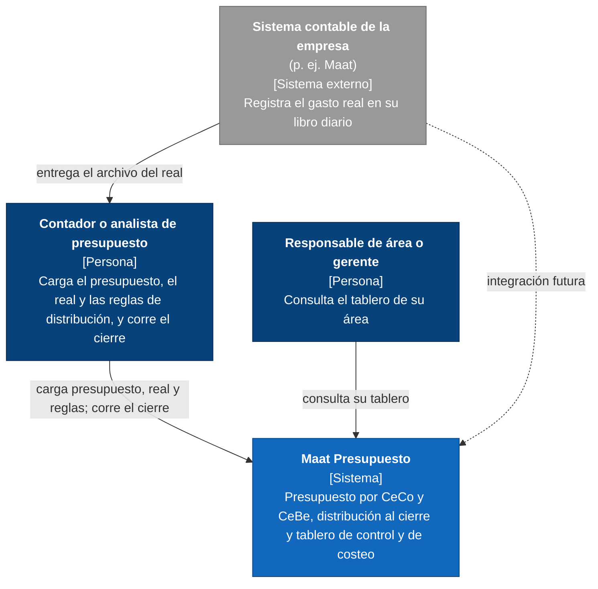
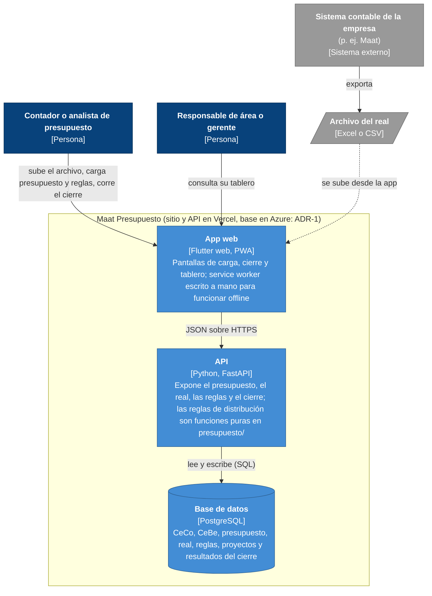

# Arquitectura de Maat Presupuesto (C4)

Maat Presupuesto lleva el presupuesto mensual por centros de costo (CeCo) y de beneficio (CeBe), carga el real que sale de la contabilidad, lo distribuye al cierre con reglas (montos fijos más el resto por porcentaje o inductor) y lo muestra en un tablero con dos vistas: control (el real antes de distribuir contra el presupuesto del CeCo responsable) y costeo (el costo por área después de distribuir).

## Nivel 1: contexto

**Por qué este diseño:**

- **El real entra por archivo y no por una integración directa con la contabilidad.** Elegí el archivo porque priorizo la **interoperabilidad** sobre tener los datos en tiempo real: cualquier sistema contable sabe exportar un archivo, y así Maat Presupuesto no depende de la API de un proveedor. El costo es que el real llega con el retraso de la exportación, lo que basta para un control mensual. A futuro, cuando Maat Presupuesto se integre a Maat como su módulo de presupuesto, el real se leerá directo del libro diario de Maat (la flecha punteada).
- **El presupuesto controla y no bloquea, y la distribución corre al cierre.** Elegí comparar después del gasto porque priorizo la **simplicidad** y la **disponibilidad** sobre el control previo: Maat Presupuesto no se mete en el flujo de compras de la empresa, así que si se cae nadie deja de trabajar. El costo es que el desvío se ve después de que ocurrió.

## Nivel 2: contenedores

El CI no es un contenedor en ejecución: corre en GitHub Actions (`.github/workflows/ci.yml`) y ejecuta las pruebas de pytest en cada pull request; `main` solo acepta cambios con ese check en verde.

**Por qué este diseño:**

- **Las reglas son funciones puras separadas de la API y de la base.** Elegí separarlas porque después vamos a integrar Maat Presupuesto con Maat y sus módulos que hacen falta: priorizo la **mantenibilidad** y la **portabilidad** sobre la velocidad de desarrollo. Las reglas no dependen de FastAPI ni de PostgreSQL, así que se pueden llevar a Maat sin reescribirlas y se prueban con pytest sin levantar nada. Por la misma razón el stack (Python, FastAPI, PostgreSQL, Flutter web) es el mismo de Maat. El costo es escribir una capa más que traduzca entre la base y las reglas.
- **La app es una PWA que funciona offline.** Elegí la PWA porque priorizo la **disponibilidad** del tablero sobre la simplicidad de una web normal: el gerente puede ver su tablero aunque se le caiga la conexión. El costo es mantener el service worker y decidir qué datos se guardan en el navegador.

## Qué le corregí al borrador de la IA

- **Tecnologías:** no quité ninguna. Pregunté si eran las mismas de Maat: sí, el stack es el mismo a propósito, para poder llevar después las reglas y las pantallas a Maat.
- **Contenedores:** no sobraba ni faltaba ninguno. Aclaré que hoy en el repo solo existen las reglas en Python, las pruebas y el CI; la app, la API y la base son lo planeado.
- **Justificación de separar las reglas:** el borrador decía solo «mantenibilidad y testeabilidad». La razón real es que después vamos a integrar el sistema con Maat y sus módulos, y por eso agregué Maat como ejemplo de sistema contable y la flecha de integración futura en el nivel 1.
- **Hosting:** no estaba decidido, así que quedó «por definir» en vez de inventar un proveedor. Después se decidió en el [ADR-1](../docs/adr/0001-sitio-y-api-en-vercel-base-en-azure.md).
